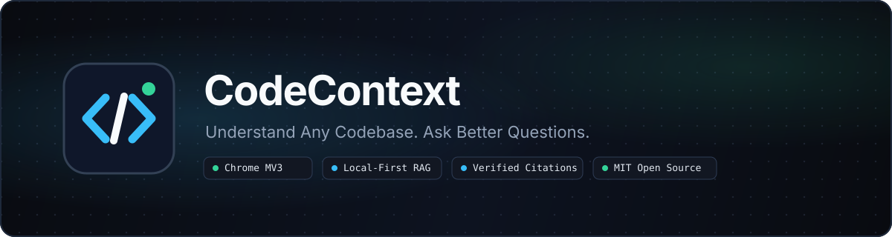
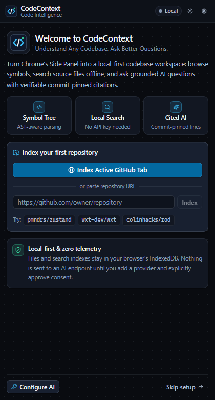
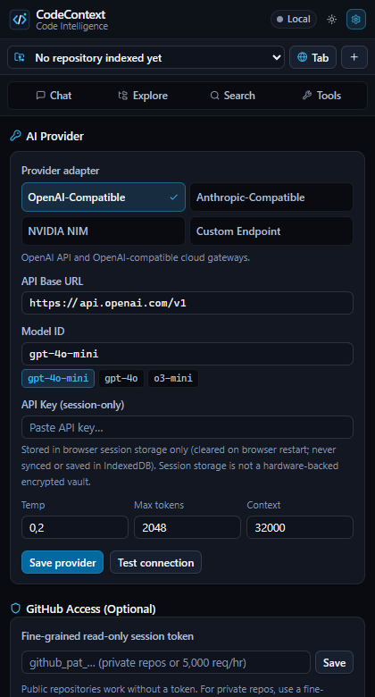
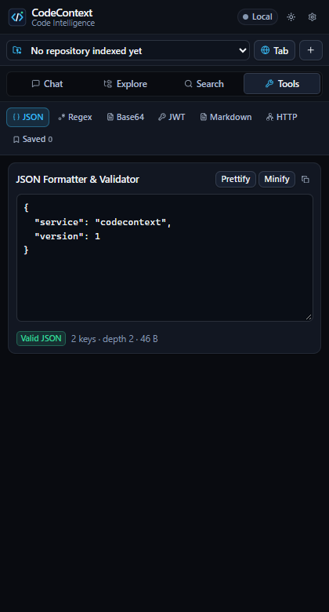
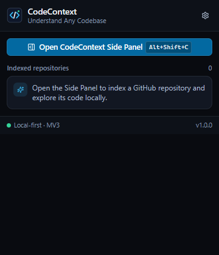
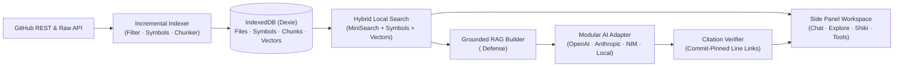

<div align="center">



<br />
<br />


<h3>Local-First AI Code Intelligence &amp; GitHub Explorer inside Chrome&apos;s Side Panel</h3>

<p>
  <a href="./LICENSE">
    
  </a>
  
  
  
  
  <a href="./CONTRIBUTING.md">
    
  </a>
</p>

<p>
  <a href="#-features">Features</a> &nbsp;·&nbsp;
  <a href="#-interface-preview">Interface</a> &nbsp;·&nbsp;
  <a href="#-quick-start">Quick Start</a> &nbsp;·&nbsp;
  <a href="#-ai-providers">AI Providers</a> &nbsp;·&nbsp;
  <a href="#-architecture">Architecture</a> &nbsp;·&nbsp;
  <a href="#-documentation">Docs</a> &nbsp;·&nbsp;
  <a href="#-author--maintainer">Author</a>
</p>

</div>

---

## Why CodeContext?

Reading an unfamiliar repository in the browser usually means juggling dozens of GitHub tabs, cloning locally just to grep a function, or pasting code into disconnected chat windows without real context.

**CodeContext** transforms Chrome&apos;s native **Side Panel** into a fast, local-first code intelligence workspace:

- **Zero-key offline exploration**: Index any public GitHub repository into local IndexedDB, explore nested file trees, jump to symbols, read READMEs, inspect dependencies, and run hybrid local search **without configuring any AI key**.
- **Verifiable, commit-pinned AI answers**: Connect OpenAI, Anthropic, NVIDIA NIM, or a local model (Ollama/vLLM) and ask codebase questions grounded in retrieved AST-aware chunks—every citation links directly to the exact lines and commit SHA.
- **Privacy by design**: Zero telemetry servers, ephemeral session-only credentials, explicit consent before external transmission, and strict prompt-injection isolation.

---

## ✨ Features

| Capability | Highlights |
|---|---|
| **GitHub Repository Intelligence** | Add repos via URL, `owner/repo` shorthand, tree/blob links, or one-click **Index Active Tab**. Supports incremental SHA-diffed syncing, rate-limit tracking, cancellation, and optional private repo fine-grained tokens. |
| **AST-Aware Indexing & Symbols** | Filters out `node_modules`, lockfiles, binaries, and build artifacts; prioritizes READMEs, manifests, and core source; extracts classes, functions, methods, interfaces, types, imports, and Markdown headings with exact 1-based line ranges. |
| **Codebase Explorer & Shiki Viewer** | Nested file tree with language dots, symbol browser, sanitized README viewer, dependency explorer (`package.json`, `requirements.txt`, `Cargo.toml`, `go.mod`), multi-color language composition bar, and fine-grained Shiki syntax viewer with line anchors & in-file search. |
| **Local Hybrid Code Search** | Powered by **MiniSearch** lexical scoring + symbol matching + filename matching + optional local semantic vector reranking—100% offline inside IndexedDB. |
| **Grounded AI Assistant (9 Modes)** | `Ask codebase`, `Explain selection`, `Explain current file`, `Explain architecture`, `Trace execution flow`, `Find usages`, `Review code`, `Explain dependencies`, `Generate docs`—with SSE token streaming and verified citations. |
| **Selection & Docs Intelligence** | Right-click any highlighted code or API documentation (`Ask CodeContext about this selection`) to explain simply/technically, find bugs, generate tests, inspect complexity, extract API parameters, or bookmark references locally. |
| **Built-in Offline Dev Utilities** | JSON Formatter & Validator, Regex Explainer & Live Tester, Base64 UTF-8 Codec, Local-Only JWT Structure Inspector, Sanitized Markdown Preview, and HTTP/cURL Explainer. |

---

## 🖼 Interface Preview

<div align="center">
  <table>
    <tr>
      <td align="center" width="50%">
        <strong>Onboarding &amp; Quick Index</strong><br /><br />
        
      </td>
      <td align="center" width="50%">
        <strong>Settings &amp; Provider Grid (Dark)</strong><br /><br />
        
      </td>
    </tr>
    <tr>
      <td align="center" width="50%">
        <strong>Offline Developer Utilities</strong><br /><br />
        
      </td>
      <td align="center" width="50%">
        <strong>Light Theme &amp; Quick Popup</strong><br /><br />
        
      </td>
    </tr>
  </table>
</div>

---

## 🚀 Quick Start

### Prerequisites
- **Node.js** 20+
- **pnpm** 9+ (or npm 10+)
- **Google Chrome** (or Chromium-based browser supporting Manifest V3 Side Panel)

### Build & Load in Chrome

```bash
# 1. Clone the repository
git clone https://github.com/MOHAMED-EL-HADDIOUI/CodeContext.git
cd CodeContext

# 2. Install dependencies & build the Chrome MV3 extension
pnpm install
pnpm run build
```

Then load the built extension into Chrome:

1. Open `chrome://extensions` and toggle **Developer mode** on.
2. Click **Load unpacked**.
3. Select the built folder: **`.output/chrome-mv3`** (or run `pnpm run release` and select **`release/codecontext-chrome-mv3`**).
4. Click the **CodeContext** icon in your toolbar → **Open CodeContext Side Panel**, or press **`Alt+Shift+C`**.

> **Tip:** Make sure you select `.output/chrome-mv3` (where `manifest.json` lives), not the root `CodeContext` source directory.

---

## 🤖 AI Providers

CodeContext works locally without an API key for indexing, exploring, syntax viewing, search, and dev utilities. When you want AI Q&A, open **Settings** and choose any adapter:

| Provider Adapter | Default Base URL | Example Model IDs | Auth |
|---|---|---|---|
| **OpenAI-Compatible** | `https://api.openai.com/v1` | `gpt-4o-mini`, `gpt-4o`, `o3-mini` | Session API key |
| **Anthropic-Compatible** | `https://api.anthropic.com/v1` | `claude-3-5-sonnet-latest`, `claude-3-5-haiku-latest` | Session API key |
| **NVIDIA NIM** | `https://integrate.api.nvidia.com/v1` | `meta/llama-3.1-70b-instruct`, `qwen/qwen2.5-coder-32b-instruct` | Session API key |
| **Custom / Local** | `http://localhost:11434/v1` | `qwen2.5-coder:7b`, `llama3.1:8b`, OpenRouter / LiteLLM / vLLM | Optional |

Click **Save provider** → **Test connection** (Chrome will ask permission only for that specific endpoint origin).

---

## 🏗 Architecture



---

## 🔐 Security & Privacy

- **Ephemeral session credentials**: API keys and optional GitHub tokens live strictly in `chrome.storage.session`—never written to IndexedDB, never synced, never exposed to content scripts, and cleared when Chrome exits. *(Disclosed transparently: browser session storage is not a hardware-backed encrypted vault.)*
- **Explicit transmission consent**: No retrieved code excerpt is transmitted externally until you configure a provider and explicitly approve consent.
- **Prompt-injection & XSS defenses**: Untrusted repository files and READMEs are wrapped inside `<untrusted_code_data>` boundaries and rendered exclusively through DOMPurify-sanitized Markdown.
- **Least-privilege MV3**: Narrow permissions, zero remote executable JS, local `web-tree-sitter` WASM (`public/wasm/tree-sitter.wasm`) under `'wasm-unsafe-eval'`.

---

## 🧪 Scripts & Quality Checks

```bash
pnpm run dev          # Hot-reload development build in Chrome
pnpm run typecheck    # Strict TypeScript compiler check (tsc --noEmit)
pnpm run lint         # ESLint static analysis
pnpm test             # Vitest unit & integration suite (24 tests)
pnpm run build        # Production Chrome MV3 bundle (.output/chrome-mv3)
pnpm run test:e2e     # Playwright Chromium + axe-core WCAG AA verification
pnpm run release      # Verified unpacked + ZIP package in release/
```

---

## 📚 Documentation

| Document | Description |
|---|---|
| [docs/ARCHITECTURE.md](./docs/ARCHITECTURE.md) | System modules, ingestion pipeline, hybrid retrieval, and storage boundaries |
| [docs/SECURITY.md](./docs/SECURITY.md) | Threat model, CSP, credential isolation, prompt-injection & XSS defenses |
| [docs/PRIVACY.md](./docs/PRIVACY.md) | Local-first data handling, third-party transmission rules, and data deletion |
| [docs/DEVELOPMENT.md](./docs/DEVELOPMENT.md) | Local dev setup, directory layout, installed skills, and testing workflow |
| [CHROMEWEBSTORE.md](./CHROMEWEBSTORE.md) | Store listing copy, plain-English permission justifications, and checklist |
| [THIRD_PARTY_NOTICES.md](./THIRD_PARTY_NOTICES.md) | Open-source dependency license attributions |
| [CHANGELOG.md](./CHANGELOG.md) | Release history |
| [CONTRIBUTING.md](./CONTRIBUTING.md) | How to contribute bug fixes, docs, and features |

---

## 🗺 Roadmap

- [ ] Optional downloadable WebGPU / Transformers.js neural embedding models cached locally
- [ ] Interactive cross-file symbol call-graph & dependency map visualization
- [ ] Pull Request diff review mode directly from GitHub PR tabs
- [ ] Multi-repository workspace comparison queries

---

## 👤 Author & Maintainer

Built and open-sourced by **Mohamed El Haddioui**.

<p>
  <a href="https://github.com/MOHAMED-EL-HADDIOUI">
    
  </a>
  <a href="https://mohamedelhaddioui.netlify.app/">
    
  </a>
  <a href="https://www.linkedin.com/in/mohamed-el-haddioui">
    
  </a>
  <a href="mailto:mohamedelhaddioui99@gmail.com">
    
  </a>
</p>

## 📄 License

Distributed under the **MIT License**. See [LICENSE](./LICENSE) for details.

<div align="center">
  <sub>If CodeContext helps you navigate codebases faster, consider giving the repo a ⭐ on GitHub!</sub>
</div>
